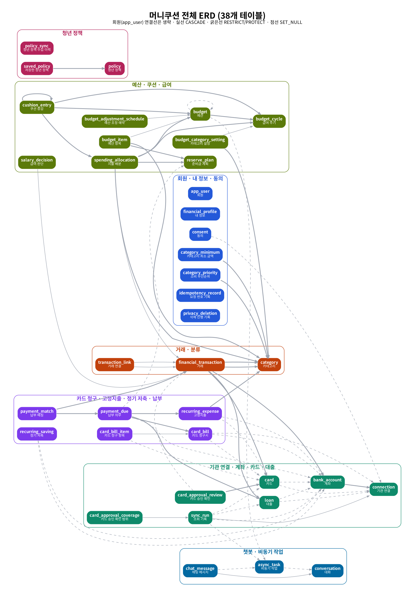
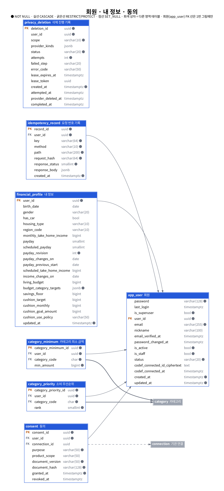
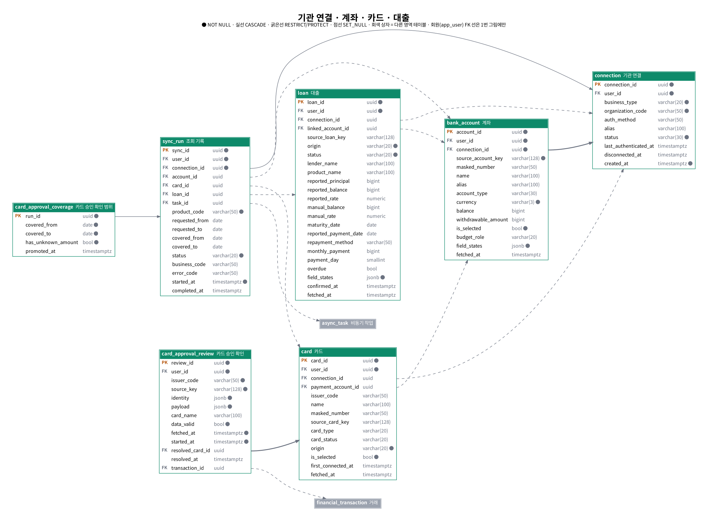
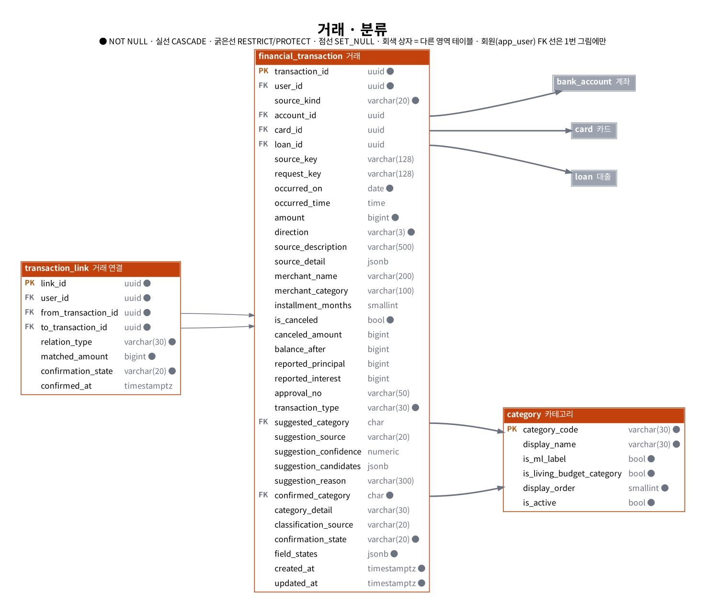
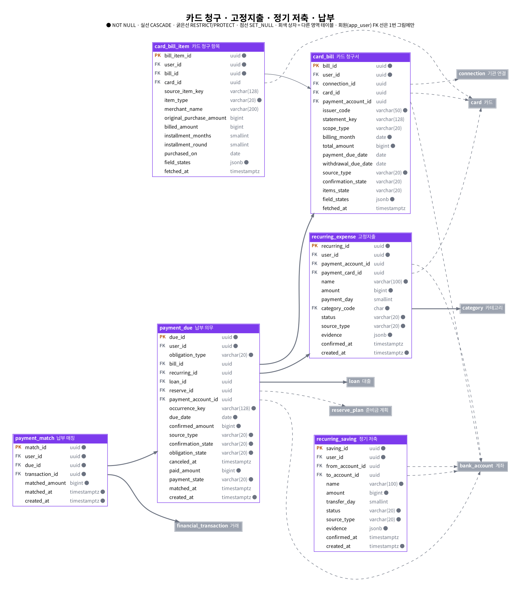
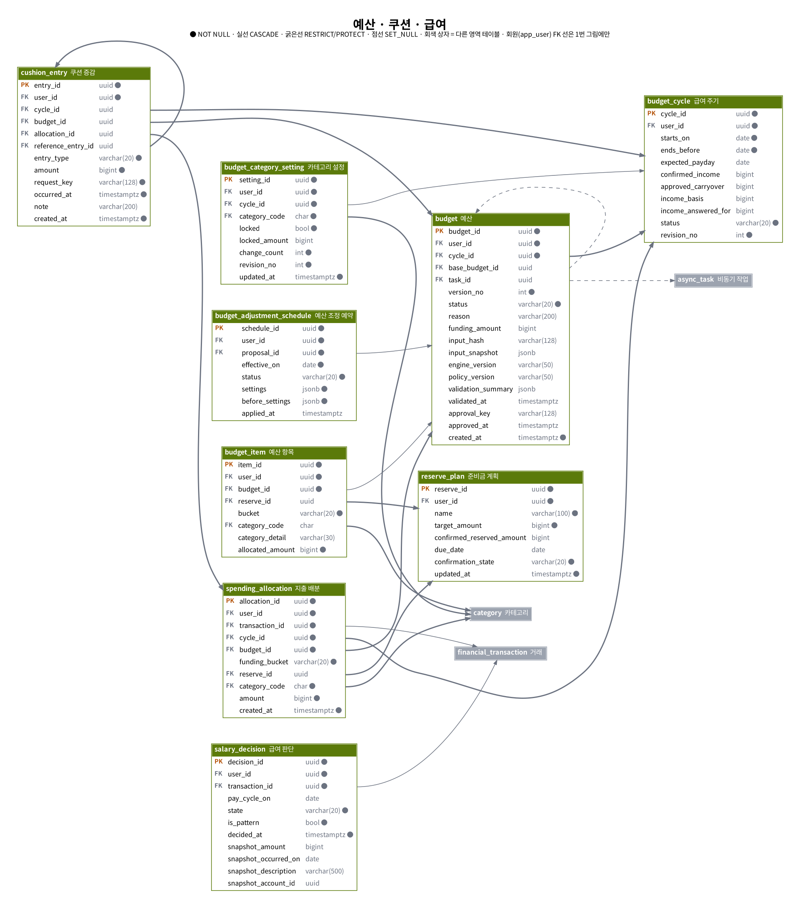
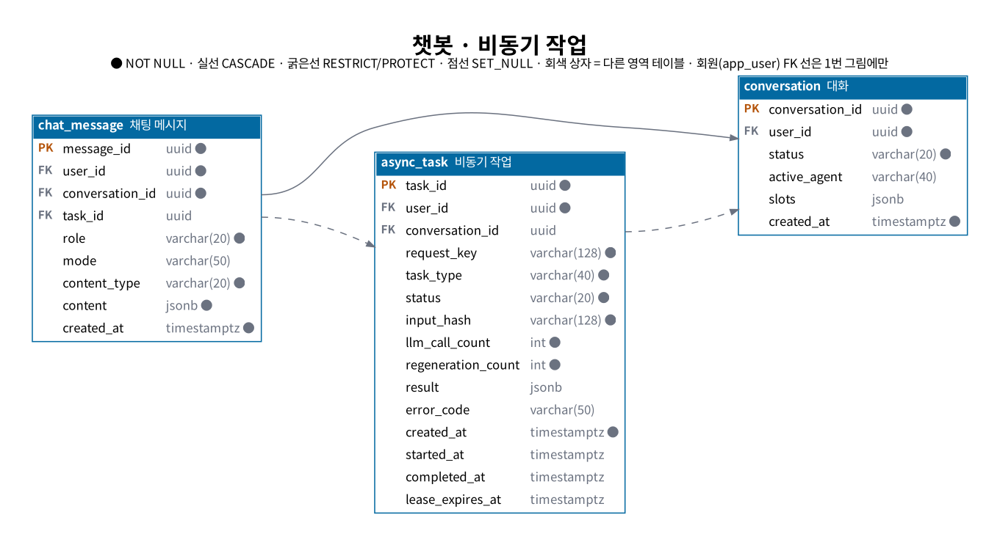
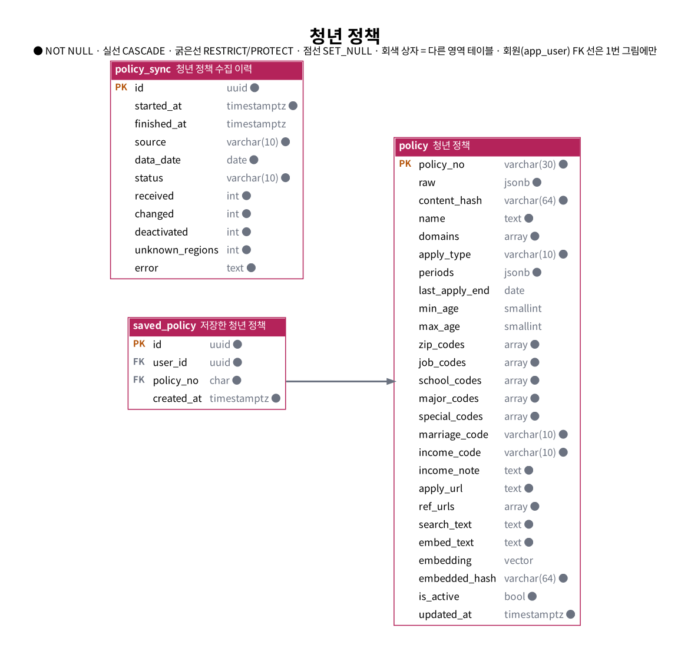

# DB 모델 구조

머니쿠션 데이터베이스의 테이블 구성, 영역별 ERD, DB가 직접 지키는 규칙을 정리한다.
모델 코드는 `backend/<앱>/models.py`, 테이블 이름은 각 모델의 `Meta.db_table`이다.

| 항목 | 내용 |
|---|---|
| DB | PostgreSQL 17 + pgvector (Docker 이미지 `pgvector/pgvector:pg17`) |
| 테이블 | **38개** (users 7 · finance 15 · budgets 10 · chat 3 · policies 3) + 다대다 연결 표 2개 + Django 기본 표 |
| 칸(컬럼) | 472개 |
| FK | 95개 — 삭제 규칙 CASCADE 43 · RESTRICT 27 · SET_NULL 24 · PROTECT 1 |
| 금액 | 원 단위 정수 (`bigint`) |
| ID | UUID (예외: `category`는 카테고리 코드, `financial_profile`은 회원 ID가 곧 PK) |

## 1. 전체 ERD



- 영역별 색으로 묶었다. 거의 모든 테이블이 회원(`app_user`)을 가리키므로 전체 그림에서는 회원 연결선을 생략했다.
- 선 모양: 실선 CASCADE(부모가 지워지면 같이 삭제) · 굵은선 RESTRICT/PROTECT(자식이 있으면 부모 삭제 막음) · 점선 SET_NULL(부모가 지워지면 빈 값).
- 그림은 현재 모델에서 자동으로 만든다: `python scripts/make_erd.py` (Graphviz · Noto Sans CJK KR 글꼴 필요). 모델을 바꾸면 다시 실행한다.

## 2. 영역별 테이블

영역별 그림에는 칸 이름 · 타입 · PK/FK · NOT NULL(●)을 표시했다. 다른 영역의 테이블은 회색 상자로 보인다.

### 2-1. 회원 · 내 정보 · 동의 (`users`)



| 테이블 | 모델 | 내용 |
|---|---|---|
| `app_user` | `User` | 회원. 이메일로 로그인한다 (`AUTH_USER_MODEL`) |
| `financial_profile` | `FinancialProfile` | 내 정보 · 예산 기준 (회원당 1개). 월 실수령액 · 급여일 · 거주 형태 · 생활비 · 쿠션 목표 · 사는 지역 |
| `category_priority` | `CategoryPriority` | 소비 우선순위. 1~3위 필수, 4위부터 선택 |
| `category_minimum` | `CategoryMinimum` | 카테고리 최소 금액 (설정한 카테고리만) |
| `consent` | `Consent` | 약관 · 개인정보 · 금융 조회 · AI 동의 기록. 철회해도 행은 남기고 `revoked_at`만 채운다 |
| `idempotency_record` | `IdempotencyRecord` | 같은 저장 요청이 두 번 와도 한 번만 반영하기 위한 요청 번호 기록 |
| `privacy_deletion` | `PrivacyDeletion` | 동의 철회 · 회원 탈퇴의 삭제 진행 기록 |

### 2-2. 기관 연결 · 계좌 · 카드 · 대출 (`finance`)



| 테이블 | 모델 | 내용 |
|---|---|---|
| `connection` | `Connection` | 은행 · 카드사 등 기관 연결 1건. 해제해도 행은 남기고 `disconnected_at`만 채운다 |
| `bank_account` | `BankAccount` | 계좌. 번호는 가린 값과 HMAC 중복 확인 키만 저장한다 |
| `card` | `Card` | 카드. 결제 계좌 연결, 최초 연결 시각 |
| `loan` | `Loan` | 대출. 기관 조회 값과 직접 등록 값(잔액 · 금리)을 나눠 저장한다 |
| `sync_run` | `SyncRun` | 기관 조회 1회 기록 (조회 범위 · 결과 · 연결된 비동기 작업) |
| `card_approval_review` | `CardApprovalReview` | 어느 카드인지 특정하지 못한 카드 승인. 사용자가 카드를 확인한다 |
| `card_approval_coverage` | `CardApprovalCoverage` | 카드 승인 조회 당시의 범위 · 차단 원인. 다대다 표 `card_approval_coverage_reviews` · `card_approval_coverage_cards` |

### 2-3. 거래 · 분류 (`finance` · `budgets`)



| 테이블 | 모델 | 내용 |
|---|---|---|
| `financial_transaction` | `FinancialTransaction` | 계좌 · 카드 · 대출 거래. 거래 유형(소비 · 이체 · 소비 아님 등), 추천 · 확정 카테고리, 분류 출처 · 신뢰도 |
| `transaction_link` | `TransactionLink` | 거래끼리의 연결 (내 계좌 간 이체 짝, 카드값 출금 ↔ 카드 사용 등) |
| `category` | `Category` | 소비 카테고리 (아래 4번). 쓰던 카테고리는 지우지 않고 `is_active=False`로 숨긴다 |

### 2-4. 카드 청구 · 고정지출 · 정기 저축 · 납부 (`finance`)



| 테이블 | 모델 | 내용 |
|---|---|---|
| `card_bill` | `CardBill` | 카드 청구서 (카드사 명세서 단위) |
| `card_bill_item` | `CardBillItem` | 청구서 항목 (일시불 · 할부 회차 등) |
| `recurring_expense` | `RecurringExpense` | 고정지출. 직접 등록 또는 거래에서 감지한 후보. 삭제하지 않고 상태를 중지로 바꾼다 |
| `recurring_saving` | `RecurringSaving` | 정기 저축 (내 계좌끼리 매달 같은 금액을 보내는 적금 · 청약 등) |
| `payment_due` | `PaymentDue` | 납부 의무 1회차 (카드값 · 고정지출 · 대출 상환 · 준비금) |
| `payment_match` | `PaymentMatch` | 납부 의무 ↔ 실제 납부 거래 (분할 납부면 여러 줄) |

### 2-5. 예산 · 쿠션 · 급여 (`budgets`)



| 테이블 | 모델 | 내용 |
|---|---|---|
| `budget_cycle` | `BudgetCycle` | 급여 주기 (`starts_on` 이상 ~ `ends_before` 미만). 이번 주기 수입 기준 |
| `budget_category_setting` | `BudgetCategorySetting` | 주기별 카테고리 자물쇠 · 변경 횟수 |
| `reserve_plan` | `ReservePlan` | 준비금 계획 (예: 연말 경조사비) |
| `budget` | `Budget` | 예산 1개 버전. 추천 · 조정안은 새 버전으로 만들고, 주기마다 적용(approved)은 최대 1개 |
| `budget_item` | `BudgetItem` | 예산 항목 (카테고리 · 저축 · 쿠션 · 준비금). 여윳돈은 저장하지 않고 재원 − 항목 합계로 계산한다 |
| `budget_adjustment_schedule` | `BudgetAdjustmentSchedule` | 다음 급여 주기부터 적용할 예산 조정 예약. 지금 적용 중인 예산은 바꾸지 않는다 |
| `spending_allocation` | `SpendingAllocation` | 소비 1건을 어느 재원(카테고리 · 여윳돈 · 쿠션 등)에서 얼마 충당했는지 |
| `cushion_entry` | `CushionEntry` | 쿠션 증감 기록. 현재 확보액 = `amount` 합계. 지우지 않고 정정은 새 줄로 남긴다 |
| `salary_decision` | `SalaryDecision` | 입금 1건의 급여 판단. 거래당 한 줄이라 한 거래가 두 급여 회차에 붙지 않는다 |

### 2-6. 챗봇 · 비동기 작업 (`chat`)



| 테이블 | 모델 | 내용 |
|---|---|---|
| `conversation` | `Conversation` | 대화. 지금 담당 에이전트(`active_agent`)와 대화 중 기억할 값(`slots`) |
| `chat_message` | `ChatMessage` | 채팅 메시지 (사용자 · 도우미, 글 · 카드 등 내용 종류) |
| `async_task` | `AsyncTask` | 예산 추천 · 조정, 금융 조회 같은 오래 걸리는 작업. 같은 요청 번호로 다시 요청하면 새로 만들지 않는다 |

### 2-7. 청년 정책 (`policies`)



| 테이블 | 모델 | 내용 |
|---|---|---|
| `policy` | `Policy` | 온통청년 정책 한 건. 원본과 정리한 값(지역 · 나이 · 기간 등), 검색용 임베딩 |
| `policy_sync` | `PolicySync` | 정책 수집 이력. 마지막 성공 건의 기준일이 데이터 기준일이다 |
| `saved_policy` | `SavedPolicy` | 회원이 저장한 정책 |

## 3. DB가 막아 주는 규칙 (CHECK · UNIQUE)

잘못된 값은 서비스 코드보다 먼저 DB에서 막는다. 정해진 코드 값(상태 · 종류 등)은 모두 CHECK로 묶여 있다.

| 테이블 | 막는 것 |
|---|---|
| financial_profile | 급여일 1~31 밖, 생활비 · 쿠션 적립액 음수, 쿠션 목표 범위 밖, 거주 형태 · 급여일 변경 · 수입 변경 값 오타 |
| category_priority | 같은 회원이 같은 순위 2개, 같은 카테고리를 두 순위에, 순위 0 이하 |
| category_minimum | 같은 회원이 같은 카테고리 두 번, 최소 금액 1원 미만 |
| consent | 조회 범위가 bank · card · loan 아님 |
| idempotency_record | 같은 회원 · 같은 요청 번호 두 번 |
| privacy_deletion | 같은 대상의 진행 중 삭제 2건 |
| connection | 같은 회원 · 업권 · 기관에 '연결 중' 2개 (해제 후 재연결은 가능), 해제 상태와 해제 시각 불일치 |
| bank_account · card · loan | 같은 연결 안에서 같은 원천 키 두 번, 계좌 종류 · 출처(origin) · 상태 · 상환 방식 오타 |
| loan | 월 상환액 1원~1억 밖, 납부일 1~31 밖, 직접 등록 잔액 0~10억 밖, 금리 0~30% 밖 |
| sync_run | 조회 대상(계좌 · 카드 · 대출)을 2개 이상 지정 |
| card_approval_review | 같은 회원 · 카드사 · 원천 키 두 번 |
| financial_transaction | 같은 원천 거래 두 번, 원천 종류와 원천 FK 짝 불일치, 금액 음수, 취소액이 0~원거래 금액 밖, 신뢰도 0~1 밖, 방향 · 거래 유형 · 확인 상태 · 분류 출처 오타 |
| transaction_link | 자기 자신과 연결, 같은 연결 두 번, 관계 종류 오타 |
| card_bill · card_bill_item | 같은 명세서 · 항목 두 번, 범위 · 확정 상태 · 항목 종류 오타, 할부 회차 0 이하, 이번 회차 > 총회차 |
| recurring_expense · recurring_saving | 금액 1,000원~1억 밖, 납부 · 이체일 1~31 밖, 상태 · 출처 오타, 보내는 계좌 = 받는 계좌 |
| payment_due | 같은 회차 두 번, 의무 종류와 원천 FK 짝 불일치, 취소 상태와 취소 시각 불일치, 납부 상태 오타, 납부액 음수 |
| payment_match | 같은 의무 · 거래 짝 두 번, 매칭 금액 0 이하 |
| budget_cycle | 같은 시작일 두 번, 시작일 ≥ 종료일, 상태 오타, 수입 기준 0 이하 |
| budget_category_setting | 같은 주기 · 카테고리 두 번, 잠긴 금액 음수, 자물쇠가 풀렸는데 잠긴 금액이 있음 |
| budget | **주기마다 적용(approved) 2개 이상**, 같은 주기 · 버전 번호 두 번, 같은 승인 요청 두 번, 상태 오타, 자기 자신을 이전 예산으로 |
| budget_adjustment_schedule | 대기 중인 예약 2개 이상 |
| budget_item · spending_allocation | 빈칸 포함 중복 줄 (`NULLS NOT DISTINCT`), 재원 종류 오타, 준비금인데 준비금 계획 없음 |
| cushion_entry | 같은 요청 두 번, 초기액 2번, 배분 1건에 사용 2번, 종류별 부호 · 필수 연결 위반, 자기 자신 참조 |
| salary_decision | 판단 상태 오타, 상태와 급여 회차 불일치, 확정 패턴 규칙 위반, 회원당 확정 패턴 2개 |
| async_task · chat_message | 같은 요청 번호 두 번, 작업 상태 · 발화자 · 내용 종류 오타 |
| saved_policy | 같은 정책 두 번 저장 |

**DB가 못 막아서 서비스 코드에서 검사하는 것** — 우선순위 1~3위 필수 · 순위 건너뛰기, 카테고리 최소 금액 합계 ≤ 생활비, 같은 회원 데이터끼리만 연결, 지출 배분의 주기 = 예산의 주기, 여러 줄 합계(예산 항목 합 ≤ 재원, 매칭 합 ≤ 거래 금액).

## 4. 소비 카테고리 (`category`)

데이터 migration으로 넣는 고정 목록이다. 코드와 이름 · 순서는 `frontend/src/utils/categories.js`와 같다.

| 구분 | 카테고리 | 예산 칸 |
|---|---|---|
| 8개 | 식비 · 교통·차량 · 생활용품 · 패션·쇼핑 · 의료·건강 · 뷰티·미용 · 교육 · 문화·여가 | ✅ |
| 예산 밖 2개 | 주거·통신 · 여행·숙박. 소비로는 집계하고 생활비 예산에서는 빼서 '예산 밖 지출'로 안내 | ❌ |
| 기타 (`ETC`) | 10개 범위 밖 지출 | ✅ |
| 미분류 (`UNCLASSIFIED`) | 아직 판단하지 못한 지출. 화면에는 '확인 필요' | ❌ |

## 5. 모델 작성 규칙

1. 회원은 `settings.AUTH_USER_MODEL`로 가리킨다.
2. PK는 `UUIDField(primary_key=True, default=uuid.uuid4, editable=False)`. 예외는 `category`(카테고리 코드)와 `financial_profile`(회원 ID).
3. `class Meta: db_table = "테이블 이름"`으로 테이블 이름을 정해 둔다.
4. 다른 앱 모델은 문자열로 가리킨다 (`"budgets.Category"`).
5. 삭제 규칙: 회원 소유 데이터는 CASCADE, 기록을 지키려는 참조는 RESTRICT, 있어도 되고 없어도 되는 참조는 SET_NULL(`null=True, blank=True`).
6. 지우면 안 되는 기록(동의 · 기관 연결 · 고정지출 · 쿠션 기록)은 행을 지우지 않고 상태 · 시각 칸으로 표시한다.
7. 정해진 코드 값은 `choices`와 CHECK 제약을 같이 둔다.

## 6. 확인 · 변경 방법

```bash
cd backend
python manage.py migrate                 # 테이블 만들기 · 변경 적용
python manage.py makemigrations --check  # 모델과 migration이 맞는지 (CI에서도 검사)

# 테이블 목록 · 한 테이블 구조 (칸 · 제약 · FK)
docker exec money-cushion-db psql -U money_cushion -d money_cushion -c "\dt"
docker exec money-cushion-db psql -U money_cushion -d money_cushion -c "\d payment_due"
```

- 모델을 바꾸면 `makemigrations`로 만든 migration 파일을 모델 코드와 같이 커밋한다. 이미 커밋한 migration은 고치지 않고 새로 만든다.
- 관리자 화면(`http://127.0.0.1:8000/admin`)에서도 테이블을 볼 수 있다.
- 모델을 바꾼 뒤에는 `python scripts/make_erd.py`로 ERD 그림도 다시 만든다.
